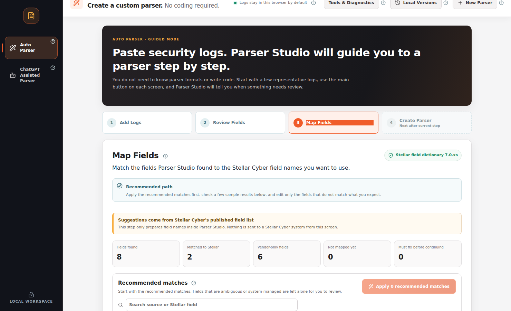

# Map Fields: Stellar Cyber 7.0 정규화

현재 제품은 **Stellar Cyber 7.0 필드 사전**을 기준으로 추천 매핑을 제공합니다. 사용자에게 6.5/6.6 스키마 선택을 요구하지 않습니다.

## 필드별 확인 사항

1. **Field found in the log**와 원본 예시 값을 비교합니다.
2. **Stellar field name** 또는 **Vendor field name**가 실제 의미와 맞는지 확인합니다.
3. **Value type**이 값의 형식과 일치하는지 검토합니다. IP는 IP, 포트는 포트/숫자 등으로 확인합니다.
4. **Vendor fields retained**는 추정해서 표준 필드에 넣지 말고 원본 의미를 보존합니다.
5. **Must fix before continuing**에 해결하지 못한 문제가 남으면 **Create Parser**로 진행하지 않습니다.

다른 이벤트 유형에만 존재하는 attack, signature, user, URL 같은 필드는 해당 이벤트에 실제로 존재할 때만 출력됩니다. 없는 필드를 장비명만으로 만들어서는 안 됩니다.

## 여러 이벤트 유형의 매핑

**Event type to map**이 표시되면 각 유형을 선택해 필드 매핑을 직접 추가·수정·삭제합니다. 유형별 매핑 변경은 다른 유형에 영향을 주지 않지만 공통 매핑 변경은 모든 유형에 적용됩니다. 변경이 거부되면 해결하거나 취소한 뒤 진행합니다. 안전한 미매핑 필드는 **Keep as vendor field**로 보존할 수 있습니다. 미매핑 값 보존 모드에서 매핑을 제거하면 원래 벤더 필드가 유지되며 **Leave out of output**은 생성 결과에서 명시적으로 제외하는 동작입니다. 원본 로그는 변경하지 않습니다.

## 흔한 오류

- **출발지와 목적지 주소가 바뀜**: source / destination 원본 값 비교
- **숫자 필드에 high 같은 문자열**: 자료형 변경 또는 벤더 전용 필드 보존
- **중복된 출력 이름**: 대상 필드 충돌을 검토하고 안전하게 수정
- **타임스탬프 정보 부족**: 연도·시간대 등 불명확한 값을 임의로 생성하지 않음

[최종 파일 생성 방법](/ko/workflows/create-and-download) · [매핑 오류 사례](/ko/scenarios/normalization)
