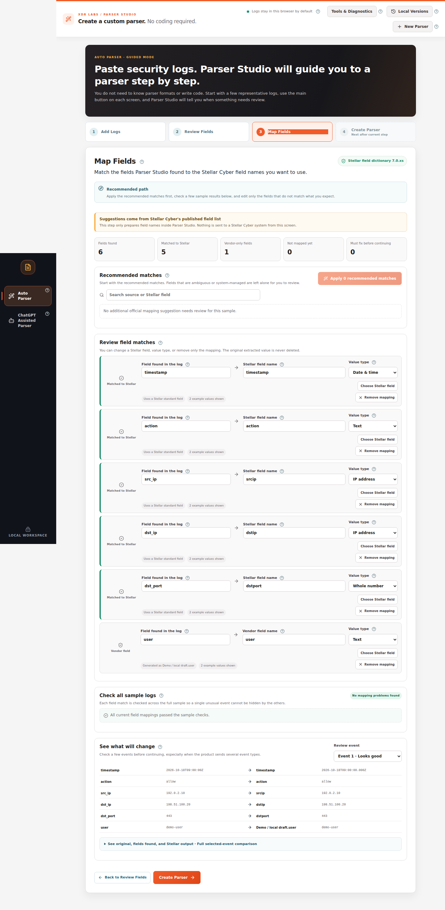
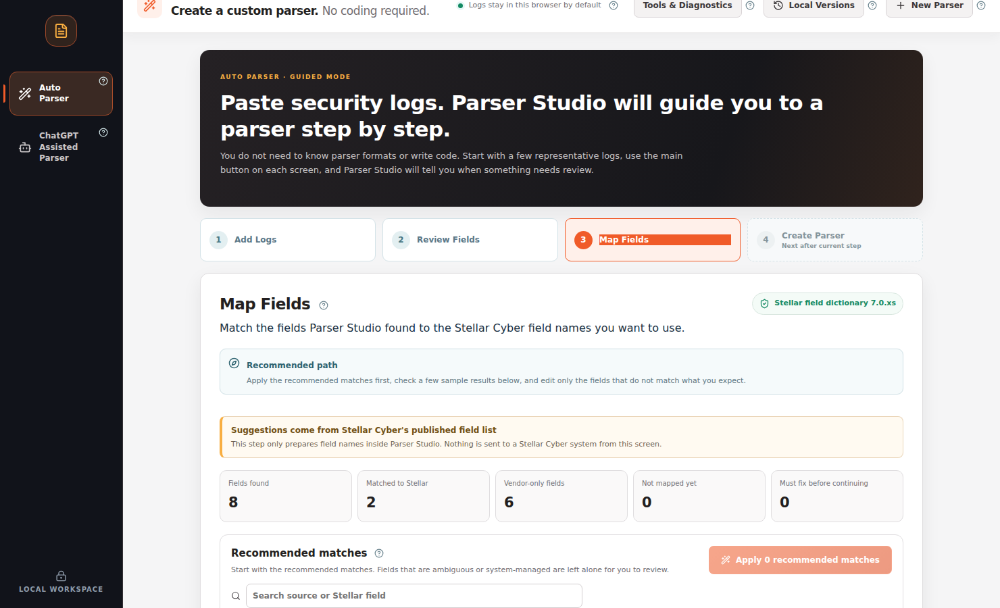

# Map Fields: where should each value go?

The prior step extracted the values. **Map Fields** chooses the names and types used for the final parser output. You do not have to know all field names beforehand; Parser Studio suggests them for review.

*Recommended matches appear here, alongside the warnings that must be resolved.*

## When the suggested mapping is already correct

1. Look at **Matched to Stellar**, **Vendor fields retained**, and **Must fix before continuing**.
2. Find **Review field matches** if you need to inspect a specific field.
3. Compare **Field found in the log**, **Stellar field name**, **Value type**, and the example values.
4. If the mapping is correct and there are **0** mandatory fixes, continue by pressing **Create Parser**.

You do not need to change a correct automatic suggestion. Check the original value and its meaning before accepting the destination.

## When a field was mapped incorrectly

Suppose the source event contains an IP address, but the proposed field name would change its meaning.

1. Find the matching source field under **Review field matches**.
2. Use **Choose Stellar field** (when available) to select the intended field in the field catalog.
3. Check **Value type** (for example, **IP address**, **Network port** or **Date & time**). Do not use a type just because it makes the warning disappear.
4. Inspect **Check all sample logs** and **See what will change**.
5. Reopen a second event using **Review event** and confirm the new destination receives the same original value.

If you cannot confirm an official destination, keep the value under a vendor-specific field rather than forcing a misleading match.

## Mapping multiple event types

When **Event type to map** is shown, select each event type and review, add, change or remove its field matches manually. Changes to a type-specific match do not change the other types; changes to a shared match apply to all types. If a change is refused, finish or undo it before continuing. Use **Keep as vendor field** for a safe unmapped source path when appropriate. A removed match retains the original vendor field when the draft preserves unmapped values; **Leave out of output** explicitly omits it from the generated output. The original log remains unchanged.

## If a warning blocks the next step

| Finding | What to check |
| --- | --- |
| **Two fields use the same destination** | Give distinct source values distinct, valid destinations |
| **Value does not match type** | Inspect all sample examples and select a compatible supported type |
| **Source field is missing from some logs** | Determine whether the field is optional or wrongly named |
| **Unverified or reserved field name** | Choose a verified catalog field or retain an appropriate vendor field |

The original source value is not changed by a mapping edit.

## Continue

When **Must fix before continuing** is **0**, click **Create Parser**. If a previously working source becomes incomplete, return to the analysis step rather than inventing a mapping.

[Complete the output step](/workflows/create-and-download) or [see a full normalization example](/scenarios/normalization).

## Current dictionary baseline: Stellar Cyber 7.0

The current public application displays **Stellar field dictionary 7.0.xs**. Check original source meaning, target name, and type. Do not infer an older version from the device firmware, and preserve ambiguous values as vendor-specific fields.

